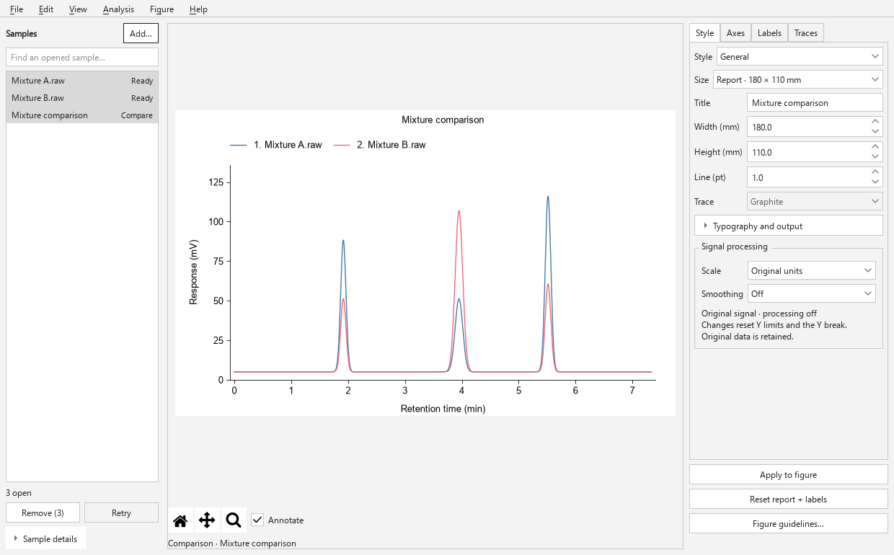
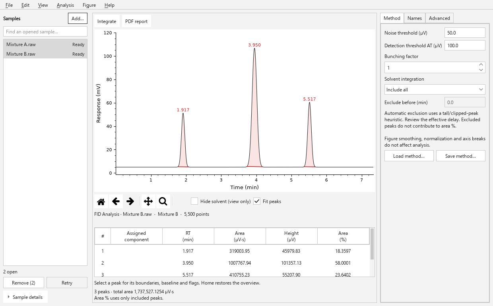

# Chromatogram Viewer

Chromatogram Viewer is a Windows desktop application for viewing and analyzing gas chromatography data. This was built for our analytical and instrumental analysis labs and reads raw data directly from PerkinElmer instrumentation including the Clarus GC-FID and GC-MS 2400. It supports chromatogram viewing, analysis, figures formatted for publication, reports, and Excel exports.



## Run on Windows

Chromatogram Viewer is distributed as a portable app for 64-bit Windows, to download:

1. Go to the [latest release](https://github.com/damianivn/chromatogram-viewer/releases/tag/v0.1.0) and download `ChromatogramViewer-x.x.x-Windows-x64.zip` from the **Assets** section.
2. Right-click the downloaded ZIP and choose Extract All.
3. Open the extracted `ChromatogramViewer` folder and run `ChromatogramViewer.exe`.

>**Note:** Microsoft Defender SmartScreen may show a "Windows protected your PC" warning. Click **More info**, then **Run anyway**. This should only appear on the first launch.


#### Running from source
To run Chromatogram Viewer from source or contribute to development, you'll need [Python 3.12 or newer](https://www.python.org/downloads/) on Windows.

Clone the repository and run setup, replacing the example path with the location of your python executable
```bat
git clone https://github.com/damianivn/chromatogram-viewer.git
setup_qt.bat "C:\Path\To\Python312\python.exe"
run.bat
```

This requires an internet connection to install dependencies into a project-local environment. You only need to run setup the first time, for subsequent launches double-click `launch_qt.vbs` to open the viewer without a console window

## Inspect a GC-MS run

1. Choose **File → Open → GC-MS acquisition** and select a supported MassLynx/TurboMass `.raw` **folder**.
2. Once it loads, select the sample to view its total ion chromatogram. To access MS data open **Analysis → GC-MS inspection / EIC**.
3. Choose the MS function and the type of trace you want. For a mass spectrum, enter a retention time for a single scan or a time interval to average several scans. For an extracted ion chromatogram (EIC), enter an *m/z* value to follow the nearest recorded mass channel across the run. Click **Update preview**.

For a sequence of samples navigate to **File → Open → Sample library**, then select a folder containing the .raw folders, then (optionally) select a .spl sample list to filter and assign sample list data.

## Integrate a GC-FID run

1. Choose **File → Open → GC-FID acquisitions** and select a PerkinElmer TotalChrom `.raw` **file**. The raw acquisition contains the signal and scaling information, so you can work directly from a completed run without a vendor result file.
2. Select the sample, choose **View → FID Analysis**, review the settings under **Method**, and click **Integrate**.
3. Select a peak in the results table to inspect its baseline and boundaries. Use **File → Export** to save the peak table as CSV, or click **PDF report** for a printable chromatogram and table.



If the viewer flags detector clipping treat that peak’s height and area as lower bounds. The [TotalChrom format notes](docs/TOTALCHROM_FORMAT.md) explain how the reader converts counts to microvolts and how the integration results compared with vendor reports.

Similarly to GC-MS, for a sequence of samples navigate to **File → Open → Sample library**, ensure the directory is set to search for "GC-FID .raw files" and select a folder containing the .raw files, then (optionally) select a .spl sample list to filter and assign sample list data.

The [usage guide](docs/USAGE.md) covers workspace navigation, reusable FID methods, component naming, and numerical exports.

## License

Chromatogram Viewer is distributed under the [MIT License](LICENSE).
